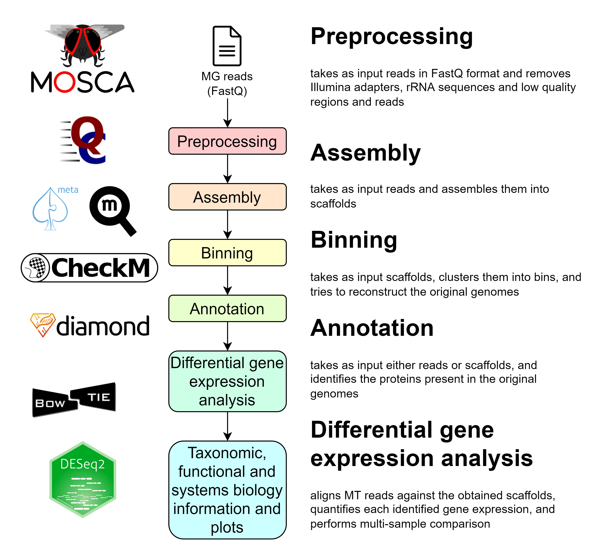

### Hi there! 👋

I was a PhD student, using bioinformatics to "Uncover the role of conductive nanomaterials in anaerobic digestion".

### Tools for meta-omics analyses

My work has mostly been the development of tools for analyses of meta-omics data, i.e., the study of the collective genomes, transcriptomes or proteomes of a microbial community.

These are the main tools I have developed for meta-omics analyses:

#### UPIMAPI, reCOGnizer and KEGGCharter

[UPIMAPI](https://github.com/iquasere/UPIMAPI), [reCOGnizer](https://github.com/iquasere/reCOGnizer) and [KEGGCharter](https://github.com/iquasere/KEGGCharter) are tools developed for the analyses of omics data, and optimized for handling the challenges of meta-omics.

<p align="center">
    
</p>

#### MOSCA

[MOSCA](https://github.com/iquasere/MOSCA) is a powerful pipeline developed for metagenomics (MG), metatranscriptomics (MT) and metaproteomics (MP) integrated analyses.

<p align="center">
    
</p>


#### Finally, some metrics about my coding routine:

<!--START_SECTION:waka-->


**I'm an Early 🐤** 

```text
🌞 Morning                1791 commits        ██████░░░░░░░░░░░░░░░░░░░   23.47 % 
🌆 Daytime                3995 commits        █████████████░░░░░░░░░░░░   52.35 % 
🌃 Evening                1446 commits        █████░░░░░░░░░░░░░░░░░░░░   18.95 % 
🌙 Night                  400 commits         █░░░░░░░░░░░░░░░░░░░░░░░░   05.24 % 
```
📅 **I'm Most Productive on Wednesday** 

```text
Monday                   1340 commits        ████░░░░░░░░░░░░░░░░░░░░░   17.56 % 
Tuesday                  1746 commits        ██████░░░░░░░░░░░░░░░░░░░   22.88 % 
Wednesday                1921 commits        ██████░░░░░░░░░░░░░░░░░░░   25.17 % 
Thursday                 1080 commits        ████░░░░░░░░░░░░░░░░░░░░░   14.15 % 
Friday                   1015 commits        ███░░░░░░░░░░░░░░░░░░░░░░   13.30 % 
Saturday                 57 commits          ░░░░░░░░░░░░░░░░░░░░░░░░░   00.75 % 
Sunday                   473 commits         ██░░░░░░░░░░░░░░░░░░░░░░░   06.20 % 
```


📊 **This Week I Spent My Time On** 

```text
💬 Programming Languages: 
YAML                     5 hrs 8 mins        ████████████████████████░   95.29 % 
Markdown                 11 mins             █░░░░░░░░░░░░░░░░░░░░░░░░   03.46 % 
Python                   2 mins              ░░░░░░░░░░░░░░░░░░░░░░░░░   00.71 % 
Nginx configuration file 1 min               ░░░░░░░░░░░░░░░░░░░░░░░░░   00.52 % 
JSON                     0 secs              ░░░░░░░░░░░░░░░░░░░░░░░░░   00.03 % 

🐱‍💻 Projects: 
ansible-puli             5 hrs 23 mins       █████████████████████████   100.00 % 
```

🤖 **AI Coding This Week** 

```text
No AI Coding Activity Tracked This Week
```

**I Mostly Code in Python** 

```text
Python                   11 repos            ████████░░░░░░░░░░░░░░░░░   32.35 % 
HTML                     10 repos            ███████░░░░░░░░░░░░░░░░░░   29.41 % 
Java                     4 repos             ███░░░░░░░░░░░░░░░░░░░░░░   11.76 % 
Shell                    2 repos             █░░░░░░░░░░░░░░░░░░░░░░░░   05.88 % 
JavaScript               1 repo              █░░░░░░░░░░░░░░░░░░░░░░░░   02.94 % 
```


 Last Updated on 22/10/2026 22:04:54 UTC
<!--END_SECTION:waka-->
